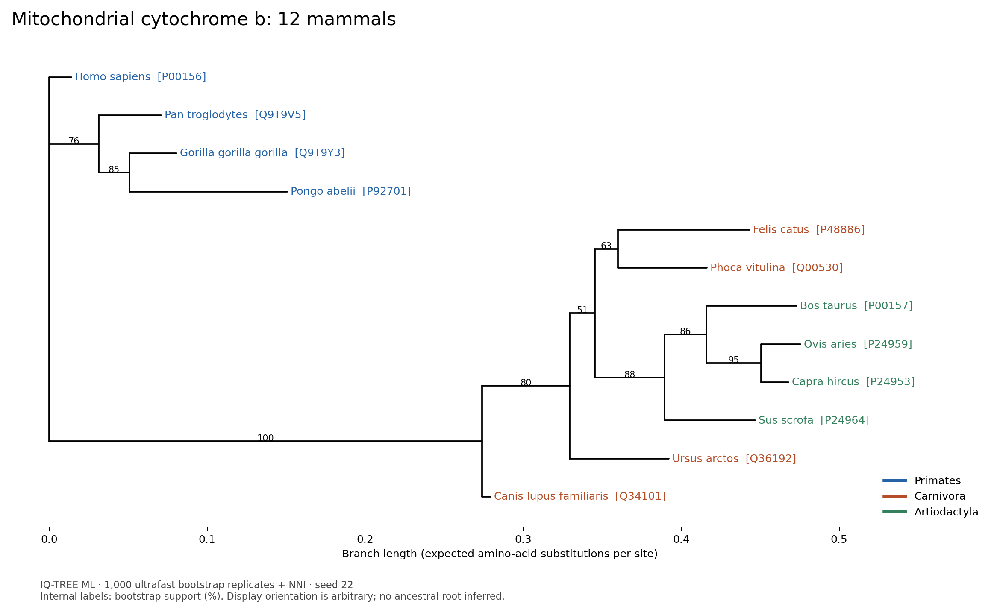

# Protein family phylogenetics

[](https://github.com/Akkaya-Furkan/protein-phylogenetics/actions/workflows/ci.yml)

## Question

Does the tree topology of a protein family agree with known taxonomy?

This experiment asks a bounded version: do four sampled members of each of
Primates, Carnivora, and Artiodactyla form an exclusive edge split in an unrooted
mitochondrial cytochrome b protein tree? The reference classification is the
lineage attached to each UniProt record. Agreement is assessed at order level,
not against a complete reference species tree.

## Approach

1. Download reviewed, full-length **cytochrome b (CYTB)** records from UniProtKB
   for 12 preselected mammal taxa, four per order. Require an exact protein name,
   a matching taxon ID and lineage, 350–400 residues, and standard amino acids.
   Choose the lowest accession deterministically if multiple records qualify.
2. Freeze the complete API response, sequences, per-record versions, taxonomy,
   download URL, release, retrieval timestamp, and SHA-256 provenance. Analysis
   and CI use this snapshot without contacting UniProt.
3. Align with **MAFFT 7.526** (`--auto --thread 1`). Verify identical identifiers,
   equal row lengths, and unchanged ungapped sequences.
4. Infer a maximum-likelihood tree with **IQ-TREE 2.4.0**. ModelFinder selects by
   BIC among mitochondrial amino-acid models (`-m MFP -msub mitochondrial`).
   Run **1,000 ultrafast bootstrap replicates with NNI correction**
   (`-B 1000 -bnni -wbt`), seed 22, one thread.
5. Test each order as an unrooted edge bipartition, checking both sides of every
   edge. Report its bootstrap support only if the split exists. Check all
   bootstrap tip sets and independently count bootstrap split frequencies in
   pytest. The display orientation supplies no biological root.

The frozen source is UniProt release **2026_03**, retrieved **24 October 2026**.
See [scope and acceptance criteria](docs/SCOPE.md),
[source provenance](data/source/provenance.json), and
[metadata with accessions and source links](data/source/metadata.json).
Some source records use subspecies names; the sample represents 12 distinct
binomial species, with one protein per species.

## Results

The topology agrees with **2 of 3** sampled order splits. Carnivora is not an
exclusive group in this tree; this is retained as a negative result.

| Order | Sampled taxa | Exclusive unrooted split | Ultrafast bootstrap support |
|---|---:|---|---:|
| Primates | 4 | Present | 100% |
| Carnivora | 4 | Absent | Not applicable |
| Artiodactyla | 4 | Present | 88% |

| Measurement | Observed |
|---|---:|
| Accessions / species / distinct sequences | 12 / 12 / 12 |
| Input protein length | 379–380 aa |
| Aligned sequences × columns | 12 × 380 |
| Gap cells / alignment cells | 8 / 4,560 |
| Variable columns (excluding gaps as states) | 131 |
| Parsimony-informative columns | 98 |
| Model selected by BIC | mtMAM+G4 |
| Bootstrap trees / expected | 1,000 / 1,000 |
| Supported internal edges / expected | 9 / 9 |
| Internal support range | 51–100% |
| Original alignment and inference wall time | 16.361 s |

Every number above comes from the committed run, not an illustrative dataset.
Timing is the local script's measured alignment/inference/version-query time;
it excludes download, figure generation, environment setup and tests.
Machine-readable results are in [metrics.json](results/metrics.json),
[order_splits.tsv](results/order_splits.tsv), and [run.json](results/run.json).



Labels show species and UniProt accession; colors indicate order. Internal
numbers are ultrafast bootstrap percentages. Branch lengths are expected amino-acid
substitutions per site. [Download the SVG](results/tree.svg).

The Carnivora tips are interspersed with Artiodactyla in the ML topology.
The relevant mixed-group split has 51% support. The partial agreement and the
weakly supported conflict do not establish a revised mammalian taxonomy.

### Reproduce

Create the environment with Miniconda (the original run used `~/miniconda3`):

```bash
~/miniconda3/bin/conda env create -f environment.yml
source ~/miniconda3/etc/profile.d/conda.sh
conda activate p22-phylogenetics

# Verify all committed source and result checksums.
sha256sum --check results/checksums.sha256

# Recompute offline in a fresh output directory; includes 1,000 bootstraps.
python -m scripts.run_analysis --output rerun

# Includes a second, live MAFFT + IQ-TREE analysis in a temporary directory.
python -m pytest -v
```

[environment.yml](environment.yml) pins the main tool versions.
[environment-linux-64.lock.txt](environment-linux-64.lock.txt) records the exact
Linux package builds used locally; install those with
`conda create -n p22-exact --file environment-linux-64.lock.txt`.
The analysis refuses to overwrite an existing ML tree. Use a new output folder.
`python -m scripts.run_analysis --summarize-only` regenerates summaries and figures
from the existing tree and alignment without rerunning inference.

To deliberately obtain a new source snapshot, download to a separate directory:

```bash
python -m scripts.download_data --output data/refreshed
python -m scripts.run_analysis --source data/refreshed --output refreshed-results
```

A later UniProt release can change source records and results. The downloader
validates all selected records before writing and rejects unexpected pagination.
The canonical analysis is the committed `data/source` snapshot.

### Files and verification

| Path | Content |
|---|---|
| `data/source/` | Raw UniProt JSON, FASTA, metadata, retrieval provenance |
| `results/alignment.fasta` | Full MAFFT alignment |
| `results/cytb.treefile` | ML Newick tree with support labels |
| `results/cytb.ufboot` | 1,000 bootstrap replicate trees |
| `results/cytb.contree` | Bootstrap consensus tree |
| `results/cytb.iqtree`, `results/cytb.log` | Model selection, tree report, inference log |
| `results/tree.png`, `results/tree.svg` | Tree visualizations |
| `results/checksums.sha256` | Source and result integrity manifest |
| `tests/test_workflow.py` | Source, alignment, split, bootstrap, and live-tool checks |
| `.github/workflows/ci.yml` | Offline snapshot checks and real-tool integration on pushes/PRs |

Tests exercise invalid source records, modified alignments, duplicate identifiers,
root-independent split assessment, negative taxonomy agreement, all committed
bootstrap trees and a fresh full analysis. CI installs the conda environment,
runs pytest, and uploads its JUnit report. It does not download new biological data.

## Limitations

- This is a single mitochondrial protein and a deliberately small sample. It is
  not a species-tree estimate, and order-level agreement does not imply correct
  relationships within an order.
- Only the three prespecified order splits are evaluated. Formal comparison
  against an independent full species tree and topology tests: **not done**.
- Alternative aligners, alignment trimming sensitivity, alternative models and
  composition/saturation diagnostics: **not done**. A high support value does
  not exclude systematic error.
- Conventional nonparametric bootstrap: **not done**. The 1,000 replicates use
  the ultrafast approximation with NNI correction; support is not a posterior
  probability or the probability that a taxonomic group is correct.
- Outgroup rooting, molecular dating, ancestral reconstruction, and nuclear
  gene validation: **not done**. The figure's left-to-right orientation is arbitrary.
- The lineage baseline comes from the same UniProt records as the sequences.
  Independent taxonomy reconciliation: **not done**. Taxon names and boundaries
  can change between releases.

## Sources and licensing

- [UniProt REST API](https://www.uniprot.org/help/api_queries) and
  [UniProt data license](https://www.uniprot.org/help/license): source records
  retain **CC BY 4.0** terms; accessions, versions and source URLs are archived.
- [MAFFT documentation](https://mafft.cbrc.jp/alignment/software/manual/manual.html).
- [IQ-TREE ModelFinder tutorial](https://www.iqtree.org/doc/Tutorial) and
  [bootstrap command reference](https://iqtree.github.io/doc/Command-Reference).
- [UFBoot2 method](https://doi.org/10.1093/molbev/msx281).

Code is released under the [MIT license](LICENSE).
